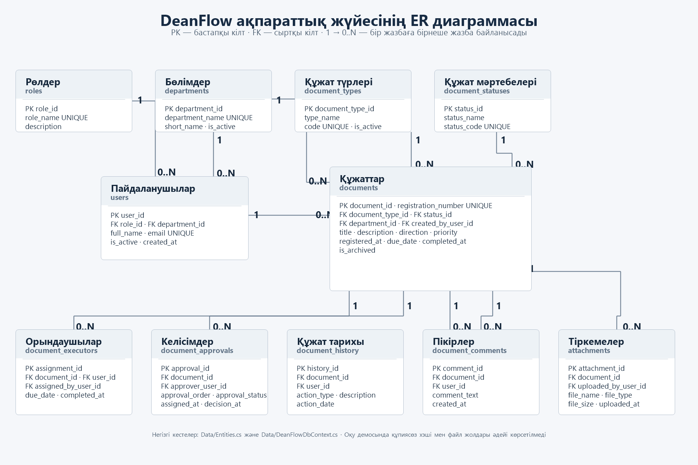

# DeanFlow

**DeanFlow** — университет деканатының құжат айналымын, орындаушыларға берілген тапсырмаларды және келісу кезеңдерін басқаруға арналған ақпараттық жүйе. Жүйеде құжатты тіркеу, іздеу, орындаушы тағайындау, мерзімін бақылау, түсініктеме мен тіркеме қосу және есеп қалыптастыру мүмкіндіктері бар. Қол жеткізу құқықтары пайдаланушының рөліне қарай шектеледі.

Жоба екі қабаттан тұрады: негізгі жұмыс істейтін жүйе **ASP.NET Core MVC + Entity Framework Core + SQL Server** арқылы іске асады; зертханалық нұсқаулықтағы Python тақырыптарын көрсету үшін `labs/deanflow-demo/` ішінде шағын **FastAPI + SQLModel + Streamlit + SQLite** демо-модулі берілген. Демо модулі негізгі жүйенің деректер қорына қосылмайды және оның құрылымын бұзбайды.

## Деректер қорының ER диаграммасы



[Диаграмманың SVG бастапқы нұсқасы](docs/diagrams/deanflow-er.svg)

Диаграммадағы негізгі байланыстар:

- Бір рөлге бірнеше пайдаланушы тіркеле алады.
- Бір бөлімге бірнеше пайдаланушы және құжат тіркеле алады.
- Бір құжат түрі мен бір мәртебеге бірнеше құжат сәйкес келеді.
- Бір пайдаланушы бірнеше құжатты тіркей алады.
- Бір құжатта бірнеше орындаушы тағайындауы, келісімі, тарих жазбасы, пікірі және тіркемесі болуы мүмкін.
- Әр орындаушы тағайындауы, келісімі және тарих жазбасы тиісті пайдаланушымен байланысады.

Негізгі қосымшаның entity-кластары `Data/Entities.cs` ішінде, ал кестелер мен сыртқы кілттер `Data/DeanFlowDbContext.cs` ішінде анықталған. Зертханалық демо диаграммадағы негізгі құжат, пайдаланушы, бөлім, түр және мәртебе байланыстарын шағын SQLite дерекқорында көрсетеді.

## Қолданылған технологиялар

| Бөлік | Технология |
| --- | --- |
| Негізгі веб-қосымша | ASP.NET Core MVC, Razor, .NET 10 |
| Негізгі деректер қоры | SQL Server, Entity Framework Core |
| Құжаттар мен файлдар | `App_Data/` каталогы, рұқсатты тексеретін контроллерлер |
| Зертханалық API | FastAPI, Uvicorn, SQLModel |
| Зертханалық интерфейс | Streamlit, Requests |
| Демо деректер қоры | SQLite |
| Контейнерлер | Docker, Docker Compose |
| Зертханалық тесттер | pytest, FastAPI TestClient |

## Негізгі веб-қосымшаны іске қосу

Қажет: .NET 10 SDK және жергілікті SQL Server. Әдепкі қосылым жолы `localhost\SQLEXPRESS` мекенжайын пайдаланады. Серверіңіз басқа мекенжайда болса, оны Git-ке енгізбей, `User Secrets` арқылы өзгертіңіз:

```powershell
dotnet user-secrets set "ConnectionStrings:DefaultConnection" "Server=YOUR_SERVER;Database=DeanFlowDB;Trusted_Connection=True;TrustServerCertificate=True;"
dotnet run
```

Қосымша `https://localhost:...` мекенжайында ашылады. Дерекқордың бастапқы схемасын жоба өздігінен өзгертпейді: миграцияны, кесте құруды және бастапқы деректерді енгізуді жауапты әкімші орындайды.

## Зертханалық Python демосын іске қосу

### Windows PowerShell

```powershell
cd labs/deanflow-demo
py -3.11 -m venv .venv
.\.venv\Scripts\Activate.ps1
python -m pip install -r requirements.txt
python -m app.database.seed
uvicorn app.main:app --reload
```

Бөлек терминалда интерфейсті іске қосыңыз:

```powershell
cd labs/deanflow-demo
.\.venv\Scripts\Activate.ps1
streamlit run app/frontend/ui.py
```

- Streamlit интерфейсі: `http://localhost:8501`
- FastAPI Swagger: `http://127.0.0.1:8000/docs`
- FastAPI тексеру нүктесі: `http://127.0.0.1:8000/health`

### Docker Compose арқылы

```powershell
cd labs/deanflow-demo
docker compose up --build
```

SQLite файлы `deanflow-demo-data` атты Docker томында сақталады. Қалыпты `docker compose down` оны қалдырады. `docker compose down -v` деректер томын да өшіреді.

## API маршруттары

| Әдіс | Маршрут | Мақсаты |
| --- | --- | --- |
| `GET` | `/documents` | Құжаттарды тізімдеу және іздеу/сүзу |
| `GET` | `/documents/{id}` | Бір құжатты оқу; табылмаса `404` |
| `POST` | `/documents` | Жаңа құжат құру; қате енгізілім `422` |
| `PATCH` | `/documents/{id}` | Берілген өрістерді ғана жаңарту |
| `DELETE` | `/documents/{id}` | Құжатты жою; табылмаса `404` |

Мысал сүзгі: `GET /documents?search=өтініш&status_code=IN_PROGRESS`.

## Тесттер

Зертханалық API-дің интеграциялық тесттерін демо каталогында іске қосыңыз:

```powershell
cd labs/deanflow-demo
pytest -q
```

## Зертханалық материалдар

Жеті зертхананың мақсаты, орындау реті, файлдарға шолу және қорғауға арналған қысқа жауаптар [қазақша нұсқаулықта](docs/laboratory-guide-kk.md) берілген.

Демо-модуль оқу мақсатында жасалған. Онда өндірістік жүйедегі аутентификация мен рөлдік шектеулер жоқ; нақты студент немесе қызметкер деректерін оған енгізбеңіз.
